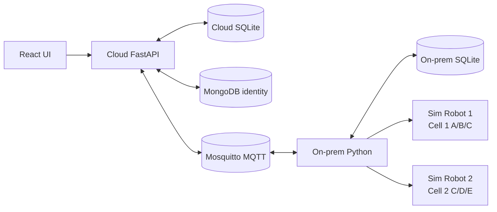

# Architecture

Cloud API/UI creates requests and renders projections. MQTT is the sole cloud/on-prem boundary. On-prem owns safety, enrollment, queues, execution, and robot state; simulated robots are internal adapters.

Allowed: UI–cloud HTTP/SSE, cloud–broker MQTT, on-prem–broker MQTT, on-prem–simulator calls. Forbidden: cloud-to-on-prem HTTP, shared operational database, cloud safety approval. MongoDB stores cloud identity records only; cloud and on-prem keep separate operational stores. Cloud data owns requests/outbox and a status projection; on-prem owns acceptance, execution, queues, safety cells, and enrollment.

Enrollment is an MQTT handshake with stable robot/site identity and capability manifest; on-prem persists approval and cloud displays it. Offline cloud publication is durable outbox/pending; on-prem inbox deduplicates and replays after reconnect. Broker persistence and durable sessions support delivery, while application records decide effects.

Safety flow: the UI asks the cloud to publish an idempotent person-entered/left command over MQTT. On-prem marks the cell occupied/clear, pauses running work and blocks starts while occupied, then resumes a paused job when clear. The decision remains on-prem and the simulation can also be driven by the on-prem endpoint or scripts when cloud is unavailable.

## Exactly-once guarantee and its boundary
MQTT delivery is at-least-once (QoS 1 may duplicate). A unique command ID/inbox row and unique execution claim ensure one simulated execution record per job; restart recovery reconciles `running` records before requeue/fail decisions. This guarantees exactly-once simulated application effect within the persisted state machine, not physical exactly-once motion. A real controller would need transactional device acknowledgements and hardware safety interlocks.
